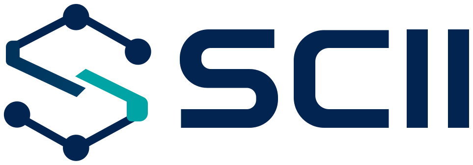
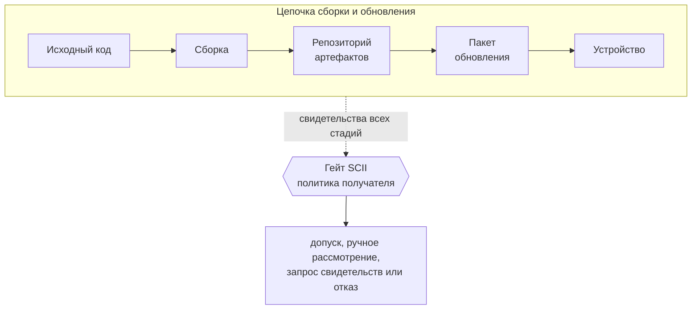
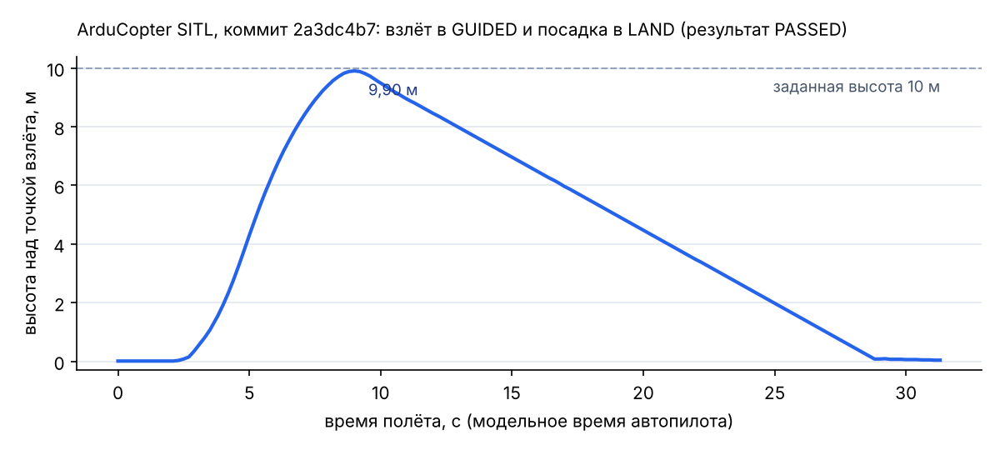

<p align="center">
  <picture>
    <source media="(prefers-color-scheme: dark)" srcset="assets/scii-logo-dark.svg">
    
  </picture>
</p>

# scii-gate

[](https://github.com/alexqzm/scii-gate/actions/workflows/tests.yml)
[](https://doi.org/10.5281/zenodo.23833592)
[](https://github.com/alexqzm/scii-gate/actions/workflows/build-attest.yml)

Гейт допуска обновлений программного обеспечения киберфизических систем по графу доказательств целостности цепочки сборки и обновления (метод SCII). Репозиторий содержит реализацию метода, профиль политики, стенд на реальной цепочке ArduPilot и результаты испытаний.

Метод и формулы описаны в статье «Метод оценки целостности цепочки сборки и обновления программного обеспечения на основе графа доказательств» (журнал «Вопросы кибербезопасности», в редакции) [уточнить: выходные данные после публикации].

## Что такое SCII

Метод SCII (англ. Supply Chain Integrity Index, индекс целостности цепочки поставки) отвечает на практический вопрос. Можно ли установить на устройство это обновление программного обеспечения?

Прежде чем попасть на устройство, обновление проходит длинный путь. Разработчики пишут исходный код. Сборочный сервер превращает его в прошивку. Прошивка хранится в репозитории артефактов. Поставщик упаковывает и подписывает её. Устройство проверяет подпись при загрузке. На любом шаге содержимое можно незаметно подменить. И на любом шаге можно получить подтверждение, что подмены не было. Такие подтверждения называются свидетельствами. Это подписи коммитов и тегов, записи о происхождении сборки (provenance), состав компонентов (SBOM), результаты повторной сборки, отчёты об испытаниях, подпись образа для защищённой загрузки.

Идея близка к цепочке хранения улик в криминалистике. Важна не только печать на последнем конверте, но и подтверждение каждого перехода из рук в руки.



SCII представляет цепочку как граф стадий. Для каждой стадии политика получателя задаёт, какие свидетельства ожидаются и насколько важно каждое из них. Рёбра графа показывают, насколько следующая стадия зависит от предыдущей. Гейт проверяет каждое свидетельство и присваивает ему одно из трёх состояний.

- **Подтверждено.** Свидетельство предъявлено и прошло проверку.
- **Отсутствует.** Свидетельства нет, или его нечем проверить.
- **Опровергнуто.** Свидетельство предъявлено, но противоречит политике. Например, подпись сделана чужим ключом или дайджест не совпадает с образом.

По состояниям вычисляется индекс от 0 до 1. Он показывает, насколько полно и согласованно целостность подтверждена по всей цепочке. Слабая стадия снижает доверие ко всем стадиям после неё. Поэтому безупречно подписанный пакет из неподтверждённой сборки получает низкую оценку.

Отдельно работает вето. Опровергнутое свидетельство на обязательной стадии блокирует обновление при любом значении индекса. Высокие оценки других стадий его не компенсируют.

Важность стадий задают эксперты, и они могут ошибаться. Поэтому гейт пересчитывает индекс при соседних значениях весов. Допуск выдаётся, только если решение устойчиво к такой ошибке. По умолчанию учитывается ошибка в классе одного ребра (окрестность N(w)). Ключ `--uncertainty box` учитывает ошибки во всех рёбрах сразу (ящик классов B(w)), для этого хватает двух проходов по графу.

На выходе гейт даёт одно из четырёх решений. Это допуск, ручное рассмотрение, запрос недостающих свидетельств или отказ. К решению прилагается отчёт с причиной по каждому свидетельству.

Индекс измеряет степень доказанности целостности, а не вероятность атаки. Низкое значение не значит, что обновление вредоносно. Оно значит, что целостность не подтверждена.

## Зачем это нужно

Атакующие всё чаще бьют не по самому устройству, а по каналу, через который оно получает программы.

- **Havex, 2014.** Кампания против промышленных систем. Злоумышленники подменили установочные файлы программ для систем управления на сайтах их производителей.
- **NotPetya, 2017.** Вредоносная программа распространилась через механизм обновления украинской бухгалтерской программы M.E.Doc.
- **ShadowHammer, 2018.** Служба ASUS Live Update раздавала заражённые обновления с действительной подписью ASUS.
- **SolarWinds, 2020.** Злоумышленники проникли в сборочную среду. Вредоносный код попал в штатно подписанные обновления Orion и ушёл заказчикам.
- **xz utils, 2024.** Закладка лежала в архивах выпуска, но не в репозитории git. Сборки из архивов её получали, а просмотр исходного кода в git её не показывал.

Во всех этих случаях программа приходила из доверенного источника. Это сайт производителя, штатный механизм обновления, действительная подпись, официальный архив выпуска. Доверие к источнику не защитило от подмены внутри цепочки. Подпись доказывает только то, кто подписал. Она не доказывает, что подписанное собрано правильным процессом из правильного исходного кода.

Индустрия уже создала инструменты для подтверждения остальных шагов. Это Sigstore, in-toto, SLSA, SBOM, воспроизводимые сборки. Но на практике остаются две проблемы.

1. Свидетельства почти всегда неполные. Проект ArduPilot, например, не публикует к выпускам ни подписей, ни SBOM, ни provenance. При этом его прошивка побитово воспроизводится из исходного кода, это показали испытания стенда.
2. Нет общего правила, как сложить разнородные свидетельства в одно решение. Обычно проверка бинарная. Если опровержений нет и обязательное на месте, обновление допускается. Такая проверка не отличает полный комплект от неполного. На стенде она допустила бы и комплект без SBOM, и комплект от скомпрометированного сборщика без контрольной пересборки.

Для киберфизических систем цена ошибки выше. К ним относятся беспилотники, промышленные контроллеры, транспорт, энергетическое и медицинское оборудование. Обновление меняет поведение физического процесса. Устройства служат годами, часто работают без сети и не могут сами выполнять тяжёлые проверки. Обновления приходят через поставщиков и интеграторов. Поэтому решение о допуске нужно принимать до раскатки на устройства, по политике получателя и с отчётом для аудита.

## Практическое значение

- **Единое правило для разнородных свидетельств.** Подписи, provenance, SBOM, повторные сборки, испытания и защищённая загрузка сводятся к одному индексу и одному решению. Правило записано в профиле политики и одинаково применяется ко всем обновлениям.
- **«Нет данных» не равно «доказана подмена».** Отсутствие свидетельства ведёт к запросу у поставщика. Опровержение ведёт к отказу. Бинарная проверка эти случаи смешивает.
- **Учёт структуры цепочки.** Подпись пакета не компенсирует неподтверждённую сборку. Отчёт показывает, на какой стадии провал.
- **Устойчивость к ошибкам экспертов.** Допуск выдаётся, только если решение не меняется при сдвиге веса любого ребра на соседний класс.
- **Объяснимость и повторяемость.** Отчёт перечисляет каждое свидетельство с причиной. Решение можно повторить по сохранённому комплекту. Для 16 комплектов стенда это делает тест в CI.
- **Требования к поставщику.** Профиль показывает, какие свидетельства ожидаются. Верхняя оценка индекса показывает, какого уровня поставщик достигнет, если предъявит недостающее. Это основа для требований при закупке и для плана улучшений.
- **Встраивание в процессы.** Гейт возвращает код 0, 10, 20 или 30. Его можно поставить условием выпуска в CI, шагом приёмки у интегратора или проверкой на сервере обновлений перед раскаткой на парк устройств.

## Чего SCII не делает

- Не ищет вредоносный код. Гейт проверяет, подтверждены ли происхождение и неизменность, а не поведение программы.
- Не заменяет независимые источники. Если все свидетельства выпускает одна скомпрометированная роль, подделку выявит только независимое свидетельство, например контрольная пересборка. На стенде такой сценарий без пересборки получил ручное рассмотрение, а не отказ.
- Зависит от якорей доверия. Если получатель не обновил политику после плановой смены ключей поставщика, подлинное обновление получит отказ.
- Не даёт универсального порога. Порог задают по эталонной записи для конкретной цепочки.

## Решения гейта

Коды возврата позволяют ставить гейт условием выпуска в CI.

| Решение | Код возврата | Когда |
|---|---|---|
| допуск | 0 | нет опровергнутых свидетельств, обязательные предъявлены, нижняя граница индекса не ниже порога (сравнение с допуском 10^-9 на ошибку округления) |
| ручное рассмотрение | 10 | индекс в зоне неопределённости или есть опровержение в необязательной стадии |
| запрос свидетельств | 20 | не предъявлено обязательное свидетельство |
| отказ | 30 | опровергнуто свидетельство обязательной стадии (вето), верхняя граница индекса ниже порога или комплект не разбирается |

Код 2 означает ошибку профиля или политики получателя. Комплект поставщика гейт считает недоверенным (с версии 0.1.6): путь вне комплекта, символическая ссылка за его пределы, файл больше 64 МиБ или не обычный файл и образ больше 32 МиБ после распаковки делают свидетельство опровергнутым, а неразбираемый `bundle.json` даёт отказ. Гейт не падает и не зависает на искажённом комплекте, это проверено на 724 комплектах испытания [scii-adversarial](https://github.com/alexqzm/scii-adversarial). С версии 0.1.7 проверки защищённой загрузки, версии и платы (s51–s53) гейт выполняет по образу пакета всегда, даже если комплект их не заявляет.

## Быстрый старт

```bash
python -m pip install -e ".[test]"
python -m pytest -q                       # модель и проверки, тесты с cosign пропускаются без него
scii-gate evaluate --profile profiles/vak2_example.json --states tests/states_vak2_scenario1.json
scii-gate evaluate --profile profiles/vak2_example.json --states tests/states_vak2_scenario1.json --uncertainty box
```

Индекс вычисляется за время O(|V| + |E|): входящие рёбра каждой вершины хранятся списком, вес каждого ребра читается за проход один раз. Замер прохода, границ индекса и всего правила (4) на цепях и разветвлённых графах до 300 тыс. вершин без проверки подписей: `python3 bench/scaling.py`, результаты в [results/scaling/scaling.md](results/scaling/scaling.md).

Проверка реального комплекта:

```bash
scii-gate verify --profile profiles/ardupilot_cubeorange.json \
                 --policy testbed/policy/policy.json --bundle <каталог комплекта> --md report.md
```

Нужны cosign 2.4.1, GnuPG и pymonocypher 3.1.3.2. Тест `tests/test_data_bundles.py` повторяет решения гейта по всем 16 комплектам из `data/bundles` и сверяет их с `results/results.json`.

Расчёты статьи о методе, включая решения пяти политик допуска на 16 сценариях стенда, пересчитывает отдельный пакет без сторонних зависимостей ([paper/evidence-graph-method](paper/evidence-graph-method/README.md)):

```bash
python3 paper/evidence-graph-method/scii_repro.py --check
```

Ссылка для цитирования: DOI [10.5281/zenodo.23833592](https://doi.org/10.5281/zenodo.23833592) (все версии), см. также [CITATION.cff](CITATION.cff).

## Стенд ArduPilot

Стенд проверяет гейт на прошивке ArduPilot Copter-4.5.7 для CubeOrange. Порядок и критерии испытаний заданы в [docs/PMI.md](docs/PMI.md) до прогона. SHA-256 ПМИ и плана записаны в [docs/PMI.sha256](docs/PMI.sha256).

```bash
export TB=/путь/к/рабочему/каталогу           # сборки, ключи, цепочки (вне репозитория)
testbed/setup.sh                              # Python 3.11, тулчейн, клон ArduPilot
testbed/builds.sh all                         # сборки и варианты нарушителя
OLD_TAG=Copter-4.5.5 testbed/builds.sh old    # предыдущий выпуск для сценария отката
testbed/keys.sh                               # ключи ролей
python testbed/pipeline.py sast && python testbed/pipeline.py tests && python testbed/pipeline.py chains
python testbed/scenarios.py run               # прогон 16 сценариев -> results/
```

## Результаты испытаний 30.10.2026

Протокол: [docs/PROTOCOL.md](docs/PROTOCOL.md). Данные прогона: [results/results.json](results/results.json), отчёты гейта по сценариям: [results/reports/](results/reports/). Видео сеанса: [results/video/scii_gate_demo.mp4](results/video/scii_gate_demo.mp4).

| Сценарий | Решение гейта | R_P | G_P |
|---|---|---|---|
| O1, O2 официальный выпуск ArduPilot (без и с контрольной пересборкой) | запрос свидетельств | 0,040 | ⊥ |
| B1 цепочка поставщика, эталонная запись | допуск | 0,577 | 1 |
| B2 без SBOM, B3 без контрольной пересборки | ручное рассмотрение | 0,458 и 0,552 | 1 |
| B5a смена ключа, старая политика / B5b обновлённая | отказ (вето) / допуск | 0 / 0,577 | 0 / 1 |
| A1a изменение пакета, A1b с переподписью ключами нарушителя | отказ (вето) | 0 | 0 |
| A2 выпуск в обход конвейера | запрос свидетельств | 0,281 | ⊥ |
| A3 архив исходников не совпадает с git (схема xz) | отказ (вето) | 0,324 | 0 |
| A4 откат на подлинный Copter-4.5.5 | отказ (вето) | 0 | 0 |
| A5a скомпрометированный сборщик, есть контрольная пересборка | отказ (вето) | 0,324 | 0 |
| A5b то же без контрольной пересборки | ручное рассмотрение | 0,552 | 1 |
| A6 тег подписан ключом вне политики | ручное рассмотрение | 0,439 | 1 |
| A7 подмена подмодуля libcanard | отказ (вето) | 0,180 | 0 |

Решения совпали с планом ПМИ в 16 сценариях из 16, состояния свидетельств в 272 парах из 272. Время гейта на комплект от 0,07 до 0,60 с.

Измеренные свойства цепочки ArduPilot:

1. Обычная сборка из тега Copter-4.5.7 побитово совпадает с официальным arducopter.apj для CubeOrange (SHA-256 55ccf3e3…69aa). Сборка с `--signed-fw` воспроизводится в чистом каталоге и в независимом клоне.
2. К выпуску не опубликованы подписи, SBOM и provenance. Коммит тега не подписан, тег лёгкий. Официальный образ без подписываемого дескриптора.
3. В подписанном образе ArduCopter поля версии дескриптора равны 0.0, загрузчик версию не сравнивает. Защиту от отката даёт только гейт.
4. Сценарий подписи `Tools/scripts/signing/make_secure_fw.py` в теге Copter-4.5.7 не запускается (SyntaxError), в ветке master исправлен.

5. На раннере GitHub (31.10.2026, workflow build-attest) обе сборки дали те же образы, что официальный выпуск и стенд. Образ 2fc03196… и apj 55ccf3e3… получили аттестацию происхождения SLSA v1 через Sigstore ([аттестация](https://github.com/alexqzm/scii-gate/attestations/62078881), Rekor logIndex 3612550422). Проверить локальный файл:

```bash
gh attestation verify arducopter.bin -R alexqzm/scii-gate \
   --signer-workflow alexqzm/scii-gate/.github/workflows/build-attest.yml
```



## Структура

| Путь | Содержание |
|---|---|
| `scii/model.py` | формулы (1)–(4): полнота, индекс, блокирующее условие, правило допуска, окрестность весов N(w) и ящик классов B(w) |
| `scii/checks.py` | проверки свидетельств: подписи git, теги, аттестации in-toto, SLSA, SBOM, журнал хранилища, cosign, защищённая загрузка ArduPilot, версия, плата, аттестации GitHub |
| `scii/gate.py` | командная строка `scii-gate` |
| `profiles/` | профиль примера статьи и профиль стенда |
| `paper/evidence-graph-method/` | пересчёт всех чисел статьи о методе, в том числе решений политик на 16 сценариях стенда (табл. 4) |
| `bench/` | замер масштабирования вычислений индекса и правила допуска |
| `testbed/` | сборки, ключи, конвейер поставщика и нарушителя, сценарии, политика получателя |
| `docs/` | ПМИ, протокол испытаний |
| `results/` | результаты прогона: results.json, отчёты гейта по сценариям, данные CI, замер масштабирования |
| `data/` | 16 комплектов свидетельств официального прогона и отчёт статического анализа |
| `.github/workflows/` | тесты и сборка с бесключевой аттестацией происхождения на GitHub |
| `assets/` | логотип проекта: SVG, PDF и PNG для светлого и тёмного фона, одноцветный вариант, знак, цвета ([assets/README.md](assets/README.md)) |

## Лицензия

Apache License 2.0, см. [LICENSE](LICENSE). Исходный код ArduPilot (GPLv3) в репозиторий не входит, стенд скачивает его по тегу. Пакеты `.apj` в `data/bundles` содержат прошивку ArduPilot и распространяются по GPLv3, подробности в [data/README.md](data/README.md).
