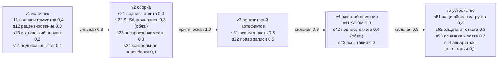
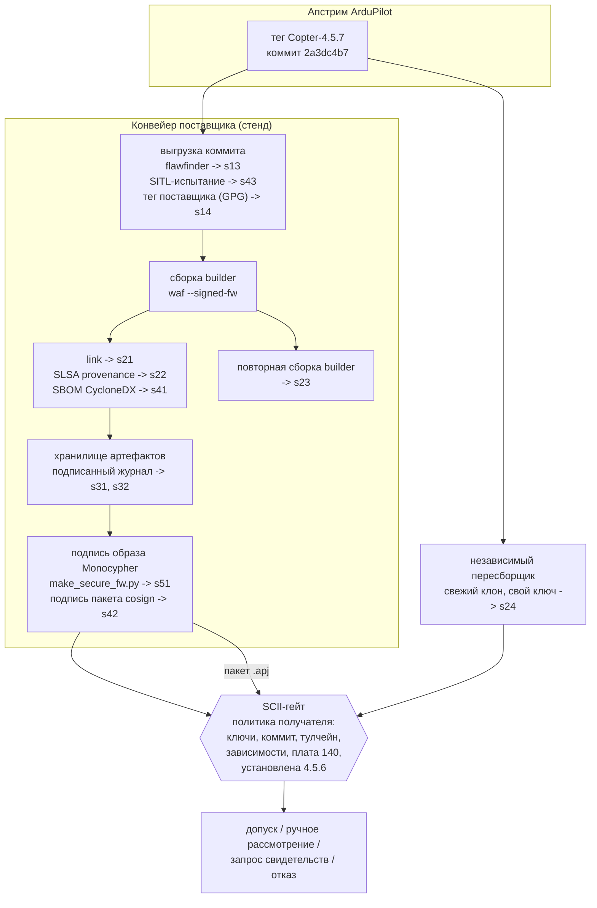

# Схемы стенда

## Граф доказательств профиля стенда

Классы рёбер и веса те же, что в примере статьи. Обязательные стадии выделены двойной рамкой.

## Роли, артефакты и проверки

Гейт восстанавливает образ сборки из пакета (обнуляет 76 байт поля подписи дескриптора). Свидетельства стадий v2 и v3 проверяются против дайджеста этого образа, поэтому пакет не может опереться на свидетельства чужой сборки.
